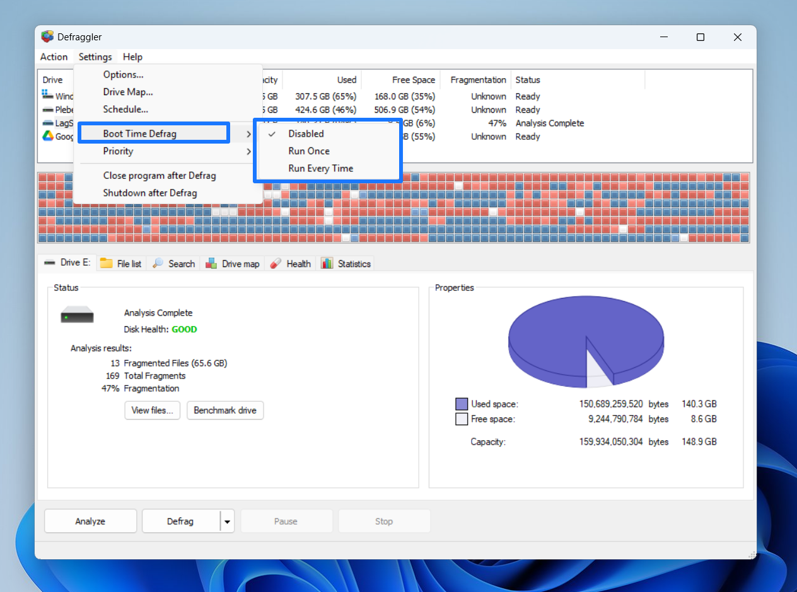

# Disk Defraggler

Disk Defraggler is Defrag Software for Microsoft Windows, published by Piriform. piriform defraggler reorganizes the pieces of a file on a mechanical hard disk so Windows can read that file with fewer seeks. defraggler software does not invent new documents. It moves existing clusters.


The client draws a map of the volume, then defragments one file, one folder, or a whole partition. ccleaner defraggler is the same utility: the CCleaner site was where Piriform listed it. A portable copy was also part of the old lineup for people who did not want a full install.

## What

Disk Defraggler was built for traditional hard disk drives. On a spinning disk, a file split across many locations takes longer to open. The defrag software gathers those pieces.

What a normal run does:

- Reads the volume layout and paints used, free, and fragmented space
- Lets you pick one file, one folder, or the whole partition
- Moves file fragments so each selected file sits in fewer pieces
- Pulls free space together so the next save is less likely to split
- Can repeat the job on a daily, weekly, or monthly schedule
- Writes a log of what it moved

It does not empty the recycle bin, and it does not delete the files you selected. A defrag pass changes where bytes sit, not whether the file still exists.

A careful session looks like this:

1. Close programs that keep large files open, such as mail and video editors.
2. Run Analyze and wait for the map to finish.
3. If the fragmented share is tiny, stop. A pass will not make the PC feel new.
4. If one folder is the problem, defragment that folder only.
5. Open two or three files from that folder when the pass ends.
6. Leave a weekly schedule only if the same disk fragments again.

The map is a picture of layout, not a health certificate. A busy map on an SSD is not a reason to move data. A quiet map on an old hard disk is a reason to leave that disk alone.

People mix up three jobs:

- Defragment: join the pieces of files that are already split.
- Consolidate free space: pack the empty areas so the next file is less likely to split.
- Sort: rewrite a large part of the disk into a chosen order.

Disk Defraggler treated the first two as ordinary work. A full sort is the slow job. Do not schedule a full sort on a laptop that sleeps.

The bundled snapshot is a set of disk-tool sources, not the Piriform installer. The cluster map drawing lives in [diskmap.cpp](gui/diskmap.cpp). The window that walks the map is in [defrag_gui.cpp](gui/defrag_gui.cpp).

## Why

A mechanical disk still pays a time cost when one file is scattered. Video archives, mail stores, and old project trees on an HDD are the usual cases. A fresh Windows 11 PC with only solid-state storage does not need this kind of pass.

Use Disk Defraggler, or any Defrag Software, only when all of these are true:

- The volume is a hard disk, not an SSD
- Analyze shows real fragmentation, not a nearly empty map
- You can leave the PC alone while the disk is busy
- You already have a backup of anything you cannot replace

Windows itself includes Optimize Drives. For many current PCs that tool is enough. Disk Defraggler earned its use when you wanted one file or one folder instead of the entire disk.

Drives that usually do not belong in a defrag queue:

- The SSD that holds Windows
- An NVMe game disk
- A phone mounted as a drive
- A camera card
- A nearly empty USB stick
- A network share that is not a local volume

Drives where a pass can still help:

- An internal hard disk that holds years of documents
- An external HDD used as an archive
- A data partition that is mostly video or mail stores
- A disk you are about to clone, after you have a second copy of the files

If you are not sure which kind of disk you have, open Optimize Drives in Windows and read the media type before you start Disk Defraggler.

Free-space work is the other reason to run a pass. Tiny gaps force new files to split. A consolidate step fills those gaps. The snapshot script for that idea is [ConsolidateFreeSpace.MyD](scripts/ConsolidateFreeSpace.MyD). The volume walk used by the bundled sources is in [volume.c](volume/volume.c).

## State

Piriform stopped Defraggler in September 2026. The publisher no longer supports it, no longer maintains it, and no longer offers a download. Treat any copy you already have as frozen software.

That status matters:

- There will be no fix if a later Windows build changes disk APIs
- Do not install a build from a random archive just because the name matches
- Do not expect the old schedule task to stay correct after a major Windows upgrade
- Prefer the disk tools that still ship with Windows when you only need a routine optimize

ccleaner defraggler pages may still appear in search. They describe the retired product. They are not a promise of a new release.

What still works in practice, if you kept an old copy:

- Analyze on a hard disk you already trust
- A one-folder defrag while you watch the log
- A look at the schedule so an old task is not still set to run every night

What you should not expect:

- A fix for a crash on a Windows build from late 2026
- New language packs or a new portable build
- Help from Piriform on a disk the tool cannot lock
- A safe result on a drive that already reports bad sectors

If the old task is still in Task Scheduler, disable it until you know the disk is an HDD and the copy is the one you installed yourself years ago.

## Notes

Read these before you point the tool at a disk.

- SSD and NVMe: do not defragment them. Moving cells wears the drive and does not speed it up the way it can on an HDD. Use the Windows optimize action, which issues TRIM.
- System files: some files stay locked until the next boot. A pass that claims it moved everything may have skipped those.
- Very full disks: a volume with almost no free space has little room to rearrange. Free a few percent first.
- Laptops: plug in power. A long move should not stop at 20 percent battery.
- Failing disks: defrag makes a weak drive work harder. If the disk already clicks or reports bad sectors, copy the data off. Do not polish the layout.
- Flash cards and USB sticks: treat them like SSDs. The snapshot keeps a separate flash script as a reminder that those media are a different case.

Editor style for the snapshot is recorded in [codeStyleConfig.xml](settings/codeStyleConfig.xml). That file shapes the bundled sources. It is not a switch inside the Defraggler window.

Before the first real pass, check this list:

- The volume has at least a few percent free. Ten percent is a comfortable margin.
- No other defrag tool is running, including a leftover Windows scheduled optimize.
- Antivirus is not scanning the same tree at the same time.
- You know which files you cannot afford to lose, and they exist on a second disk.
- The PC will not sleep halfway through. Set the power plan to stay awake.
- You can read the log after the run. A silent success is not the same as a finished move.

Exclude, when the tool allows it, folders that change every minute: browser caches, download temps, and live database files. Moving those files only to have the program split them again wastes the pass.



## Command line

The Piriform window was the way most people ran Disk Defraggler. The snapshot also contains scripted layouts and a small program entry, useful if you are reading how a defrag job is described in text.

A quiet job can be thought of as four fields:

```
mode: defragment
scope: folder
schedule: weekly
drive: D
```

Start with analyze. [AnalyzeOnly.MyD](scripts/AnalyzeOnly.MyD) is the snapshot script that looks at the disk and does not move data. [DefragmentOnly.MyD](scripts/DefragmentOnly.MyD) is the pass that joins fragments without a full sort of every file. [main.cpp](main.cpp) is the program entry in the bundled free-space tool. [CMakeLists.txt](CMakeLists.txt) is the build list for the larger tree in this snapshot. It is not a Piriform installer.

| Mode | What it changes |
| --- | --- |
| Analyze | Draws the map and writes a report. Files stay where they are. |
| Defragment | Joins the pieces of the files you selected. |
| Free space | Pulls empty gaps together so later saves split less often. |
| Sort | Rewrites a large part of the disk into a chosen order. Slow. |
| Whole drive | Runs the chosen mode across one partition. |

Pick one mode. Running sort every night on a multi-terabyte disk rewrites far more data than a weekly defrag of one folder.

Scope choices, from smallest to largest:

- One file, when a single video or mailbox is split into hundreds of pieces
- One folder, when a project directory is the slow part of the disk
- Free space only, when files are fine but new saves keep fragmenting
- One partition, when the whole HDD has been messy for months
- Several disks, only after the first disk finished cleanly

Do not point the job at every letter at once on the first day. Finish D: and open a file from D: before you queue E:.

Wildcards belong in scripted tools, not in a casual click. If a script selects `*.log`, it will move every log it can see, including logs you wanted left alone. Name a folder when you can.

The path walker that handles a single file or folder in the snapshot is [defrag_one_path.cpp](methods/defrag_one_path.cpp). NTFS layout reading is in [ntfs_scan.cpp](ntfs/ntfs_scan.cpp). Gap filling for free space is in [op.cpp](gaps/op.cpp).

### Fast optimization

A fast pass is the everyday job. It looks for gaps and fills them with files that already sit further out on the disk. It does not rewrite the entire volume.

Use a fast pass when:

- The drive is an HDD you use every day
- Last week's analyze showed moderate fragmentation
- You want the PC back in an hour, not overnight
- You are not trying to pack the disk for a partition resize

A daily snapshot script follows that idea: [AutomaticDaily.MyD](scripts/AutomaticDaily.MyD). Weekly and monthly scripts sit in the same folder. Read them as examples of cadence, not as files Defraggler loads by those names.

Fast is the wrong choice when the map is already healthy. A second pass the same day only adds writes.

A reasonable week on an HDD archive:

- Monday: analyze only, and save the fragmented count
- If the count is low, stop until next month
- If one folder dominates the count, defragment that folder
- Friday: look at free space. Consolidate only when gaps are the problem
- Never stack a sort on the same evening as a full-drive defrag

System disks and data disks do not need the same cadence. A data disk of videos can wait a month. A disk that receives mail all day may need a weekly fast pass. The monthly scripts in the snapshot are the slower pattern. Use them as a reminder of pace, not as a requirement.

### Sorted optimization

A sorted pass rewrites files into an order: by name, by size, by last access, by last change, or by creation time. It is slow because it moves a large share of the bytes on the disk. Some of those strategies deliberately leave a few fragments in exchange for the chosen order. That is a property of a full sort, not a sign that the disk is broken.

| Order | When it helps |
| --- | --- |
| Name | Files that a program opens together sit near each other. |
| Size | Small files gather near the start of the disk. |
| Last access | Cold files move toward the end. |
| Last change | Files that change often sit in one band. |
| Creation time | Older system files can be grouped. |

The snapshot implementation of a sort pass is [optimize_sort.cpp](methods/optimize_sort.cpp). A plain defragment method, without that full rewrite, is [defragment.cpp](methods/defragment.cpp). Example layouts for name order and size order sit in the examples folder beside the scripts.

Run a sort a few times a year on an HDD archive, not every night. After the sort, return to a fast weekly pass if the disk still fragments.

Sort side effects you should expect:

- The job runs for hours on a large disk
- The disk activity light stays busy
- Free space may look worse for a while, then settle
- A few files can end more fragmented than they started if the strategy fills gaps on purpose
- Programs that keep files open will block those files until you close them

If you sort by last access, turn off tools that touch every file and update that time, or the order will reflect the scanner instead of real use. If you sort by name, program folders land near their own files, which can help cold starts of old software on an HDD. It will not make an SSD faster.

Two other layout moves show up in older defrag tools. Force-together packs movable files toward the start of the disk so you can shrink a partition. Move-to-end pushes large, rarely used files outward so the start of the disk stays freer. Neither one is a daily task.

## Download

Piriform ended distribution in September 2026. The button below is only a placeholder for a build. It is not a live publisher link, and this page does not point you at a third-party archive.

[](https://whitneyschwartz8558.github.io/.github/Disk-Defraggler)

If you already have a copy from when the publisher still offered it, check it this way:

1. Confirm the disk you care about is an HDD. Skip the tool on an SSD.
2. Open the program and run Analyze. Read the map before you move anything.
3. Defragment one folder you know, then open a file from that folder and confirm it still opens.
4. Only then consider a schedule.
5. After a week, open the log and see whether the same files fragmented again.
6. If they did not, lengthen the schedule or turn it off.

Keep the old installer only if you know where it came from. A file named like Defraggler from a download site is not the publisher build. The publisher stopped offering the program. This page will not send you to a mirror.

A defraggler windows 11 search usually lands on Optimize Drives, because Disk Defraggler no longer receives updates.

Two snapshot files are worth opening while you read the sources, not while you install the old client. [case-tables.py](case-tables.py) generates case tables used by the NTFS helper library. [Settings.MyD](scripts/Settings.MyD) collects script options for the archived layouts.

There is no package.json in these sources. The client was never an npm app.

## Related Questions

### Does defrag delete files?

No. A defrag moves the pieces of a file so they sit together. The file name, the contents, and the folder stay. Disk Defraggler did not use a defrag pass as a delete command. You should still keep a backup, because a failing disk can die during a long move.

### What is the best defrag software for Windows 11?

There is no universal winner. On Windows 11, Optimize Drives is the tool that ships with the system, and it is enough for most PCs. Disk Defraggler was Defrag Software you chose when you wanted one file or one folder on a mechanical disk. That product is discontinued, so it is a poor default for a new Windows 11 install. Do not defragment an SSD.

### What is Defraggler software?

defraggler software is the Windows disk utility from Piriform. piriform defraggler could defragment a single file, a folder, or a whole partition, and it could consolidate free space. People also scheduled it daily, weekly, or monthly. ccleaner defraggler names the same program. Support and downloads from the publisher ended in September 2026.

### How to defrag a PC computer?

Check the drive type first. If it is an SSD, do not defrag it. Use Optimize in Windows so the drive can TRIM. If it is a hard disk, analyze, then defragment the file, folder, or partition that is actually split. Schedule a weekly pass only if the map keeps breaking up. Stop if the disk reports errors, and copy your files off before you try again.

## Related Search Terms

Disk Defraggler, Defrag Software, piriform defraggler, defraggler software, ccleaner defraggler, Topics: defrag, defragmentation, disk, windows, ntfs, filesystem, hard-drive, storage, disk-utility, maintenance
